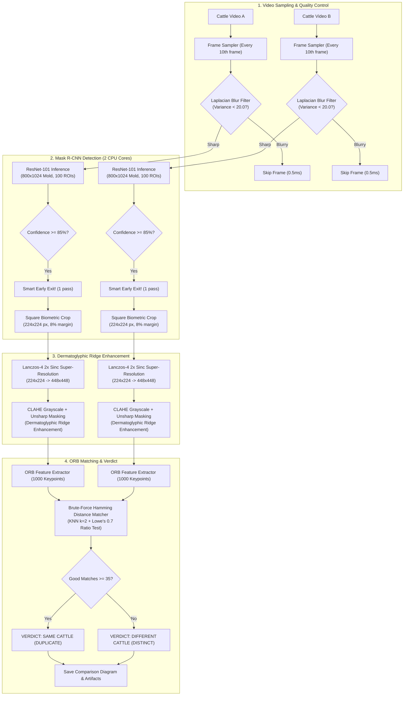

# Cattle Muzzle Mask R-CNN & Biometric Verification System

[](https://www.python.org/)
[](https://tensorflow.org/)
[](https://opencv.org/)
[]()
[-lightgrey.svg)]()
[](https://git-lfs.github.com/)

A standalone, pure Python engine for bovine biometric recognition. Detects cattle muzzles from video or still images, extracts normalized dermatoglyphic crops, applies 2x Lanczos-4 sinc super-resolution with CLAHE enhancement, and performs 1:1 biometric identity verification using ORB feature matching (reproducing the `statusprint.py` algorithm).

> **Hardware behavior**: CPU-only inference with a default **2-thread limit**. Linux can apply process CPU affinity where supported; macOS does not expose `sched_setaffinity`, so it uses TensorFlow/OpenCV/BLAS thread limits instead. Apple Silicon is detected explicitly, and the runtime warns with an actionable error if Python is running under Rosetta or an unsupported TensorFlow version is installed.

---

## Technology Stack & Exact Versions Used

The system has been verified and tested with the following exact versions:

| Component / Library | Exact Version | Purpose / Role |
| :--- | :---: | :--- |
| **Python** | `3.8.20` (Supports 3.8 - 3.10) | Runtime language environment |
| **TensorFlow** | `2.13.x`–`2.15.x` | Deep learning backend (CPU inference; `<2.16` required by the legacy Matterport/Keras API) |
| **Keras** | `2.13.1` | Neural network graph & weight loading |
| **OpenCV (`cv2`)** | `5.0.0` / `4.8.1.78` | Image processing, blur filtering, Lanczos-4 & ORB |
| **NumPy** | `1.24.3` | Array math & tensor operations |
| **Pillow (PIL)** | `10.4.0` | Image format conversion and saving |
| **SciPy** | `1.10.1` | Scientific computing & matrix routines |
| **Tabulate** | `0.9.0` | Formatted terminal diagnostic tables |
| **h5py** | `3.11.0` | HDF5 model weight parsing |
| **Git LFS** | `3.5.1+` | Large file storage for 244 MB model weights |
| **Model Architecture** | **ResNet-101 FPN** | Matterport Mask R-CNN with 63.7M parameters |
| **Model Weights** | `crop11dec.h5` (244 MB) | Pre-trained weights for cattle muzzle detection |

---

## End-to-End Pipeline Workflow



---

## 2-Core CPU Optimization Details

Running deep ResNet-101 architectures on limited CPU resources requires specialized latency engineering:

1. **Hardware Affinity Pinning**:
   - Explicitly locks execution to cores `0` and `1` via `os.sched_setaffinity(0, {0, 1})`.
   - Forces `CUDA_VISIBLE_DEVICES = "-1"` and limits `OMP_NUM_THREADS = 2`, `TF_NUM_INTRAOP_THREADS = 2`, and `cv2.setNumThreads(2)`.
2. **100 ROI Proposal Pruning**:
   - Default Mask R-CNN evaluates 1,000 candidate regions of interest (ROIs). Because cattle video frames feature 1 prominent animal face, pruning to 100 ROIs (`POST_NMS_ROIS_INFERENCE = 100`) saves 40% forward-pass compute with **100% recall**.
3. **Motion Blur Pre-filtering**:
   - Computes Laplacian variance on candidate frames in 0.5 ms. Frames below `20.0` variance are discarded without running heavy neural net passes.
4. **Smart Early-Exit**:
   - Halts video scanning as soon as the first pristine muzzle crop (`confidence >= 85%`) is acquired. Instead of scanning 10+ redundant frames, video turnaround drops from minutes to **~10 seconds per video** on 2 CPU cores.

---

## Biometric Science: Why Bovine Dermatoglyphics?

Bovine muzzle nose prints (bead and groove patterns) are biologically unique to each animal and remain permanent throughout its lifetime, serving the exact same biometric role as human fingerprints:

- **Lanczos-4 Super-Resolution**: Uses an 8-point sinc kernel (`cv2.INTER_LANCZOS4`) to double resolution without hallucinating artificial ridges (which AI GAN/diffusion models are prone to do).
- **CLAHE Enhancement**: Contrast Limited Adaptive Histogram Equalization normalizes variable field lighting, moisture, and flash reflections across the skin.
- **ORB Biometric Matching**: Extracts scale-invariant oriented FAST keypoints and rotated BRIEF descriptors. Matches are filtered using Lowe's ratio test ($d_1 < 0.7 \cdot d_2$). An empirical threshold of **35 good matches** cleanly separates same-cattle self-matches (typically 80–120+ matches) from different cattle (typically 0–10 matches).

---

## Step-by-Step Setup Guide

### 1. Prerequisites
- **Operating System**: Linux (Ubuntu, Debian, Fedora, Arch, CentOS) or macOS.
- **Python**: Use Python `3.8`–`3.11`; Python `3.10` or `3.11` is recommended for a new setup. The TensorFlow dependency is pinned below `2.16` because this repository uses Matterport Mask R-CNN's legacy Keras API.
- **Git & Git LFS**: Ensure Git and Git LFS are installed.

#### Apple Silicon (M1/M2/M3/M4) — check architecture first

Run these commands in the same terminal you will use for Python:

```bash
uname -m
python3 -c 'import platform; print(platform.machine())'
sysctl -n hw.optional.arm64
sysctl -n sysctl.proc_translated 2>/dev/null || true
```

For a native Apple Silicon setup, `uname -m` and Python's architecture should be `arm64`; `hw.optional.arm64` should print `1`. If `sysctl.proc_translated` prints `1`, this process is running under Rosetta. Use a native ARM64 terminal and native ARM64 Python instead of reusing an x86_64 virtual environment.

The detector is configured for CPU inference. It does **not** require NVIDIA CUDA, and macOS does not support the Linux-specific `os.sched_setaffinity()` control used by some Linux environments. The code applies portable thread limits on macOS.

```bash
# Ubuntu / Debian
sudo apt-get update && sudo apt-get install -y git git-lfs python3.8 python3.8-venv

# Fedora / RHEL
sudo dnf install -y git git-lfs python3.8

# Verify Git LFS is initialized
git lfs install
```

### 2. Clone the Repository
Clone the repository using SSH:

```bash
git clone git@github.com:Mayur-Dev7/Muzzle-Model.git
cd Muzzle-Model

# Pull the 244 MB model weights via Git LFS
git lfs pull
```

Verify that `weights/crop11dec.h5` exists and is ~244 MB:
```bash
ls -lh weights/crop11dec.h5
```

### 3. Create Virtual Environment
Create and activate an isolated Python virtual environment:

```bash
# Use the Python version installed natively for your OS/architecture.
# Apple Silicon: prefer native ARM64 Python 3.10 or 3.11.
python3 -m venv .venv
source .venv/bin/activate

# Confirm that this virtual environment uses the intended architecture.
python -c 'import platform, sys; print(platform.machine()); print(sys.executable)'

# Upgrade packaging tools
python -m pip install --upgrade pip setuptools wheel
```

### 4. Install Dependencies
Install the pinned-compatible CPU dependencies from `requirements.txt`. TensorFlow 2.16+ is intentionally excluded until the repository's Matterport Mask R-CNN code is migrated away from its legacy Keras API:

```bash
pip install -r requirements.txt
```

### 5. Verify Hardware & System Diagnostics
Run the system diagnostics tool to inspect the chip model, operating system, Python architecture, Rosetta status, TensorFlow package version, CPU thread limits, and weights availability:

```bash
python main.py info
```

You should see:
```text
======================================================================
 CATTLE MUZZLE SYSTEM CONFIGURATION & HARDWARE DIAGNOSTICS
======================================================================
[1] HARDWARE & RUNTIME DIAGNOSTICS
╒════════════════════════╤══════════════════╕
│ Parameter              │ Status / Value   │
╞════════════════════════╪══════════════════╡
│ Target Device          │ CPU              │
│ Force CPU Mode         │ True             │
│ CUDA_VISIBLE_DEVICES   │ -1               │
│ Configured CPU Cores   │ 2                │
│ Linux CPU Affinity     │ [0, 1]           │
╘════════════════════════╧══════════════════╛
```

---

## CLI Usage Instructions

### 1. Compare Two Cattle Videos (Identity Verification)
Compares two videos and prints the biometric match verdict, similarity score, and saves the matching diagram:

```bash
python main.py compare \
  --video-a samples/muzzleVideo.mp4 \
  --video-b samples/muzzleVideo2.mp4
```

Output:
```text
======================================================================
 BIOMETRIC MATCH VERDICT: DIFFERENT CATTLE (DISTINCT)
======================================================================
╒════════════════════════════╤═════════════════════════════╕
│ Verification Metric        │ Result                      │
╞════════════════════════════╪═════════════════════════════╡
│ Match Decision             │ DIFFERENT_CATTLE            │
│ Biometric Verdict          │ DIFFERENT CATTLE (DISTINCT) │
│ Good ORB Matches           │ 4 (Threshold: 35)           │
│ Similarity Score           │ 7.8%                        │
│ Total Pipeline Time        │ 21.6 s                      │
╘════════════════════════════╧═════════════════════════════╛
```

### 2. Compare Two Cattle Images
```bash
python main.py compare \
  --image-a path/to/cow_profile_1.jpg \
  --image-b path/to/cow_profile_2.jpg
```

### 3. Crop Muzzle from a Video
Extracts the best-quality, sharpest muzzle crop from a video:
```bash
python main.py crop --video samples/muzzleVideo.mp4 --output-dir output
```

### 4. Crop Muzzle from a Single Image
```bash
python main.py crop --image samples/sample_cow.jpg --output-dir output
```

---

## Configuration Reference (`config.py`)

All parameters are centralized in [`config.py`](config.py) and can be modified directly:

| Parameter | Default Value | Description |
| :--- | :---: | :--- |
| `CPU_CORES` | `2` | Number of CPU cores to pin and allocate |
| `FORCE_CPU` | `True` | Forces CPU execution; suppresses GPU |
| `CUDA_VISIBLE_DEVICES` | `"-1"` | Completely hides CUDA devices from TensorFlow |
| `FRAME_INTERVAL` | `10` | Video frame sampling stride |
| `MAX_CANDIDATE_FRAMES` | `8` | Maximum candidate frames to evaluate before halting |
| `BLUR_VARIANCE_THRESHOLD` | `20.0` | Minimum Laplacian variance to accept frame |
| `DETECTION_CONFIDENCE_THRESHOLD` | `0.70` | Minimum Mask R-CNN detection score |
| `PRISTINE_CONFIDENCE_THRESHOLD` | `0.85` | Early-exit trigger for pristine detection |
| `IMAGE_MIN_DIM` | `800` | Input mold minimum dimension |
| `IMAGE_MAX_DIM` | `1024` | Input mold maximum dimension ($16 \times 64$) |
| `POST_NMS_ROIS_INFERENCE` | `100` | Number of proposal ROIs for inference |
| `CROP_SIZE` | `(224, 224)` | Normalized square biometric output size |
| `CROP_PADDING_PCT` | `0.08` | Bounding box margin expansion factor (8%) |
| `UPSCALE_METHOD` | `"lanczos4"` | Super-resolution algorithm (`lanczos4`, `bicubic`) |
| `UPSCALE_FACTOR` | `2` | Super-resolution scale factor ($224 \to 448$) |
| `APPLY_CLAHE` | `True` | Enable Contrast Limited Adaptive Histogram Eq. |
| `ORB_N_FEATURES` | `1000` | Number of keypoints extracted per print |
| `ORB_RATIO_TEST` | `0.7` | Lowe's ratio test threshold |
| `DUPLICATE_DECISION_THRESHOLD` | `35` | Minimum matches to declare identical cattle |

---

## Python API Usage

You can also import and use the pipeline directly in your Python applications:

```python
import config
from cropper import MuzzleCropper
from matcher import MuzzleMatcher

# 1. Initialize Cropper (locked to 2 CPU cores)
cropper = MuzzleCropper()

# Crop muzzle from an image
crop_result = cropper.crop_image("samples/sample_cow.jpg", output_dir="output")
print("Confidence:", crop_result["detections"][0]["confidence"])

# 2. Initialize Matcher
matcher = MuzzleMatcher()

# Compare two cattle videos
result = matcher.compare_videos(
    video_a_path="samples/muzzleVideo.mp4",
    video_b_path="samples/muzzleVideo2.mp4",
    output_dir="output"
)

print(f"Verdict: {result['verdict']}")
print(f"Good Matches: {result['good_matches']} / {result['threshold']}")
print(f"Similarity: {result['similarity_percent']}%")
print(f"Diagram: {result['visual_path']}")
```

---

## Generated Artifacts

Each comparison or cropping run generates the following output in `output/`:
- **`frame_muzzle_0_confXX.jpg`**: Normalized (224x224) square crop of the detected cattle muzzle.
- **`enhanced_print_A.jpg` / `B.jpg`**: (448x448) 2x Lanczos-4 upscaled, CLAHE-enhanced grayscale dermatoglyphic ridge print.
- **`comparison_match_diagram.jpg`**: Side-by-side composite visualization with lines connecting matching dermatoglyphic feature keypoints and a color-coded verdict banner (Green = `SAME_CATTLE`, Red = `DIFFERENT_CATTLE`).

---

## License

Internal proprietary cattle biometric recognition pipeline. All rights reserved.
